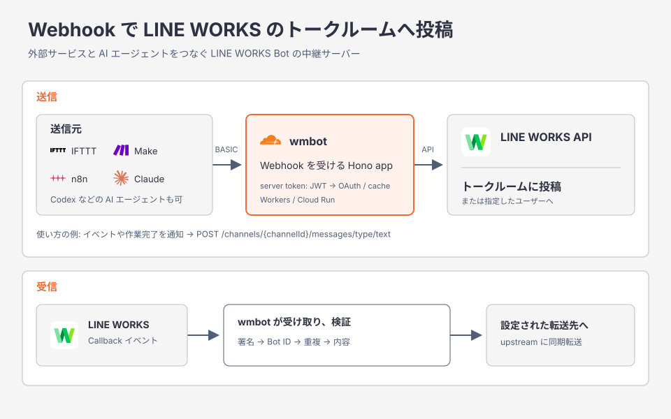

# Webhook Bot Messenger for LINE WORKS


**[IFTTT](https://ifttt.com/) や [Make](https://www.make.com/)、[n8n](https://n8n.io/)、AI エージェントから、HTTP リクエストを 1 回送るだけで LINE WORKS のトークルームに投稿できる Webhook サーバーです。**

[LINE WORKS API](https://developers.worksmobile.com/jp/docs/api) を直接呼ぶには、JWT の署名やアクセストークンの取得・更新を自分で実装する必要があります。このサーバーがそれを引き受けるので、呼び出す側は投稿したい内容を JSON で送るだけで済みます。

- **ノーコードですぐ連携**: ツールの「HTTP リクエスト」機能や AI エージェントから、そのまま呼び出せます。
- **多彩なメッセージ**: テキスト、画像、ファイル、カルーセルなど 13 種類を、トークルームにも個人宛にも送れます。
- **受信にも対応**: LINE WORKS で起きたイベントを検証して、自分のシステムへ転送できます。



## セットアップ手順

事前に [Bun](https://bun.sh/) をインストール (`.config/mise.toml` の `[tools].bun` を読む [mise](https://mise.jdx.dev/) を推奨)。

```zsh
# 1. クローン
$ git clone <repository-url> && cd worksmobile-message-bot

# 2. 依存インストール
$ bun install

# 3. .env 作成 ([環境変数](./docs/reference/environment.md)を参照)

# 4. 起動
$ bun run dev      # 開発: ホットリロード + pretty log。localhost:8080
$ bun run build && bun run start  # 本番ビルド + 起動
```

---

## 文書

- [アーキテクチャ](./docs/architecture.md)
- [HTTP API とリクエスト例](./docs/reference/http-api.md)
- [Callback の受信と転送](./docs/reference/callback.md)
- [環境変数と OAuth Scope](./docs/reference/environment.md)
- [開発コマンドと反映の流れ](./docs/operations/development.md)
- [Cloud Run へのデプロイ](./docs/operations/deploy-cloud-run.md)
- [Cloudflare Workers へのデプロイ](./docs/operations/deploy-workers.md)
- [文書索引](./docs/README.md)

### 再開前の準備

Cloud Run の再開手順は[デプロイ手順](./docs/operations/deploy-cloud-run.md#再開前の準備)を参照。

## 技術スタック

- **実行基盤**: Cloudflare Workers / Google Cloud Run
- **ランタイム**: Workers runtime / [Bun](https://bun.sh/) 1.4.x（Cloud Run・ローカル）
- **言語**: TypeScript (ESM, strict)
- **HTTP フレームワーク**: [Hono](https://hono.dev/)（Workers と Cloud Run で共通 app を実行）
- **検証**: [Zod](https://zod.dev/) + [@hono/zod-validator](https://github.com/honojs/middleware/tree/main/packages/zod-validator)
- **Linter / Formatter**: [Biome](https://biomejs.dev/) 2.x
- **Logger**: [pino](https://github.com/pinojs/pino) (+ pino-pretty in dev) — Workers logs / Cloud Run時のCloud Logging severity・trace連携
- **pre-commit**: [lefthook](https://github.com/evilmartians/lefthook)
- **CI**: GitHub Actions（develop / PR は lint・型検査・`test:fast`、main は OpenSpec・全テスト・Wrangler dry-run を含む全部入り）
- **CD**: GitHub Actions (CI 成功後) → Cloudflare Workers。Cloud Build → Cloud Runは休止中

## ライセンス

MIT ライセンスの下で公開されています。
